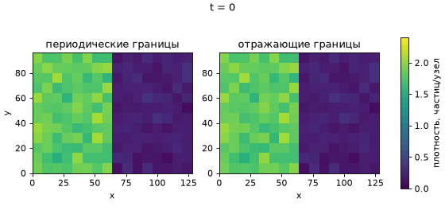

# Решётчатый газ HPP

Модель газа на квадратной решётке: перенос частиц между половинами поля при периодических и отражающих границах.



## Что делает модель

Поле состоит из узлов, в каждом узле четыре канала: вправо, вверх, влево, вниз. В канале не больше одной частицы.
Один шаг состоит из столкновения и переноса. При столкновении две частицы, летящие навстречу друг другу, разлетаются под прямым углом. Затем все частицы сдвигаются на один узел.
Границы бывают периодические (частица выходит с одной стороны и появляется с другой) и отражающие (частица у стенки летит обратно).
В начале левая половина поля заполнена плотнее правой (вероятность занятости канала 0,45 и 0,05). Программа следит, как плотности половин выравниваются.

## Установка и запуск

```
pip install -r requirements.txt
python hpp_lab.py
python hpp_lab.py --gif
python -m pytest
```

Первая команда ставит библиотеки, вторая запускает расчёт, третья ещё и делает анимацию, четвёртая запускает тесты.

## Параметры

| Параметр | По умолчанию | Что означает |
| --- | --- | --- |
| `--width` | 128 | ширина поля (чётная, не меньше 2) |
| `--height` | 96 | высота поля (не меньше 2) |
| `--steps` | 800 | число шагов по времени |
| `--runs` | 12 | число случайных начальных состояний (не меньше 2) |
| `--block` | 8 | размер блока для карт плотности (делит ширину и высоту) |
| `--gif` | выключен | сделать анимацию |

Начальные состояния задаются числами 2026, 2027 и далее, поэтому результаты повторяются от запуска к запуску.

## Что на выходе

- вывод в консоль: средний модуль разности плотностей на последних 100 шагах и шаги, на которых разность достигает максимумов;
- `results/difference.png` - разность плотностей левой и правой половин от времени;
- `results/density_maps.png` - карты плотности в четыре момента времени;
- `images/animation.gif` - анимация первого запуска (только с `--gif`).

## Как читать результаты

Разность плотностей колеблется около нуля: газ переходит из плотной половины в разреженную и возвращается обратно. Это звуковая волна. Период колебаний около W / c_s, где W - ширина поля, а c_s = 1/√2 - скорость звука в модели (узла за шаг). При отражающих границах период вдвое больше, чем при периодических.

## Ограничения

- расчёт сделан на одной сетке (по умолчанию 128 × 96);
- в модели только четыре направления движения, поэтому она анизотропна;
- сравнение с реальным газом не проводилось.
